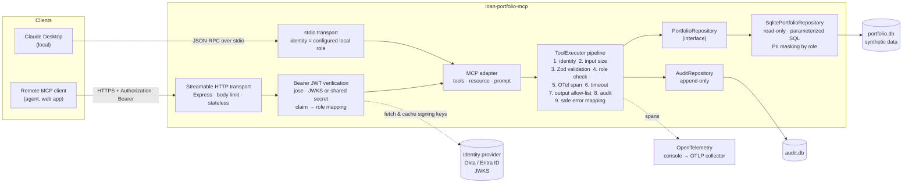
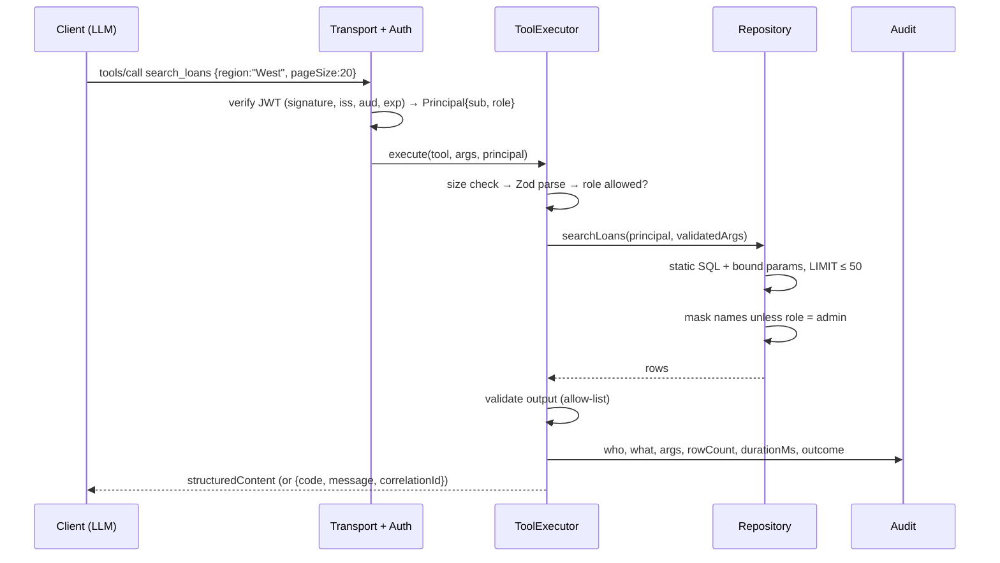

# Loan Portfolio MCP Server

A production-style [Model Context Protocol](https://modelcontextprotocol.io) server that lets an AI
assistant such as Claude Desktop answer questions about a loan portfolio. It does this by calling
safe, read-only, audited tools against a database. It never writes SQL itself.

> **All data is synthetic.** A deterministic seed script generates 200 customers, 600 loans, about
> 5,200 payments and about 1,300 risk ratings. Names come from Faker and every e-mail address uses
> the reserved `example.com` domain. No real customer, company or employer data is used anywhere.

**What this demonstrates:** typed tool contracts that an LLM can use correctly, role-based PII
masking enforced in the data layer, JWT/OAuth2 authentication, parameterized SQL only, an
append-only audit trail, OpenTelemetry tracing, and 149 automated tests.

---

## Contents

- [Try it in 2 minutes](#try-it-in-2-minutes)
- [What it does](#what-it-does)
- [Architecture](#architecture)
- [Other ways to run](#other-ways-to-run)
- [Security design](#security-design)
- [Production authentication (OAuth2 / Okta)](#production-authentication-oauth2--okta)
- [Observability](#observability)
- [Testing](#testing)
- [Project layout](#project-layout)
- [How I would adapt this to your data](#how-i-would-adapt-this-to-your-data)
- [Known limitations](#known-limitations)

---

## Try it in 2 minutes

You need Node.js 22 or 24 and Claude Desktop. You don't need a compiler or Docker.

**1. Install, build and create the demo data.**

```bash
git clone <repo-url> loan-portfolio-mcp
cd loan-portfolio-mcp
npm ci
npm run build
npm run seed:demo
```

`seed:demo` creates the database with a fixed date (31 October 2026). The answers below assume it.

**2. Get the full path to the server.** This prints it in quotes, ready to paste into JSON (on
Windows the backslashes are already doubled):

```bash
node -p "JSON.stringify(require('path').resolve('dist/index.js'))"
```

**3. Add the server to Claude Desktop.** In Claude Desktop, open Settings → Developer → Edit Config.
Paste this, and replace the quoted path in `args` with the output of step 2:

```json
{
  "mcpServers": {
    "loan-portfolio": {
      "command": "node",
      "args": ["/full/path/to/loan-portfolio-mcp/dist/index.js"],
      "env": { "STDIO_ROLE": "analyst", "LOG_LEVEL": "warn", "OTEL_TRACES_EXPORTER": "none" }
    }
  }
}
```

**4. Restart Claude Desktop and ask a question.**

The config file lives at `~/Library/Application Support/Claude/claude_desktop_config.json` on macOS
and `%APPDATA%\Claude\claude_desktop_config.json` on Windows. Use `"STDIO_ROLE": "admin"` to see
real customer names instead of masked ones.

### Five questions to try

The exact wording of Claude's answers will vary. The numbers should not.

1. **"Summarise the loan portfolio."**
   Expect: 574 active loans, about $65.7M outstanding, a weighted average rate of 8.78%, and a
   delinquency rate of 5.75% (33 loans). Claude uses `get_portfolio_summary`.

2. **"Which region has the highest delinquency rate? Which has the lowest?"**
   Expect: Southeast is highest at 9.35%, then Southwest at 8.33%. West is lowest at 3.45%. Claude
   uses `get_portfolio_summary` with a breakdown by region.

3. **"How has delinquency changed over the last 12 months?"**
   Expect: it stays between 2% and 3.4% until July 2026. Then it rises every month, to 5.75% in
   October 2026. Claude uses `get_delinquency_trend`.

4. **"Show me the five largest defaulted loans, then explain what happened to the biggest one."**
   Expect: a list headed by LN-000189, a West mortgage of about $473,000 that is 116 days past due.
   Customer names are masked, for example `A*** B***`. The borrower paid on time for ten months,
   then missed four payments in a row from July 2026. The risk grade went from C to D, then to E
   after an analyst review. Claude uses `search_loans`, then `get_loan_details`.

5. **"What exactly does 'delinquency rate' mean here?"**
   Expect: loans 30 or more days past due, divided by active loans, and it includes defaulted loans.
   Claude uses `explain_metric`. The definition comes from the server, not from Claude's general
   knowledge.

For a longer run, pick the **monthly_portfolio_review** prompt in Claude Desktop. It produces a
structured credit review that uses all five tools. For a screen-recorded walkthrough, see
[docs/demo-script.md](docs/demo-script.md).

## What it does

| Capability | Name                                 | Purpose                                                                                                                                                |
| ---------- | ------------------------------------ | ------------------------------------------------------------------------------------------------------------------------------------------------------ |
| Tool       | `get_portfolio_summary`              | Totals, weighted/simple average rate, delinquency and default rates. Filter by region or loan type, and break down by region, loan type or risk grade. |
| Tool       | `search_loans`                       | Filtered, paginated loan search (status, region, type, grade, balance range, origination dates, days past due). **Max 50 rows per call.**              |
| Tool       | `get_loan_details`                   | One loan with its customer, risk-rating history and payment history.                                                                                   |
| Tool       | `get_delinquency_trend`              | Month-end delinquency rate for the last N months (max 36), recomputed from payment history.                                                            |
| Tool       | `explain_metric`                     | Authoritative definition and formula for every metric, so the assistant doesn't guess.                                                                 |
| Resource   | `portfolio://schema/data-dictionary` | Tables, columns, enums, PII flags and metric formulas (Markdown).                                                                                      |
| Prompt     | `monthly_portfolio_review`           | A guided, multi-tool monthly credit review, for the whole portfolio or one region.                                                                     |

Each tool has a Zod input schema and a Zod output schema. Both are published to the client as JSON
Schema, together with an LLM-oriented description that says when to use the tool and how to page
through results. Every tool is annotated `readOnlyHint: true`.

## Architecture



What a single tool call goes through:



Resource reads and prompt reads use the same identity check, tracing and audit steps.

## Other ways to run

**Smoke test.** This starts the built server over stdio, the way Claude Desktop does, and calls
every tool, the resource and the prompt:

```bash
npm run smoke                 # as analyst
STDIO_ROLE=admin npm run smoke
```

**Audit log.** Show the latest audit records:

```bash
npm run audit:tail            # last 15 records; add -- --n=50 for more
```

**HTTP mode (local).**

```bash
cp .env.example .env          # set AUTH_JWT_SECRET to a random string of 32+ characters
npm run start:http            # http://127.0.0.1:3000/mcp  (.env is loaded automatically)
npm run token -- analyst      # mint a 1-hour dev token (or: admin)
```

**Docker.**

```bash
cp .env.example .env && docker compose up --build
```

The container runs as a non-root user with a read-only root filesystem and all Linux capabilities
dropped. It seeds the database on first start and exposes a `/healthz` probe. (The Docker setup has
not been run yet; see [Known limitations](#known-limitations).)

`npm run seed` (without `:demo`) uses the end of last month as the as-of date. A `.env` file in the
project root is loaded automatically; values set in the real environment, including the `env` block
in the Claude Desktop config, always take precedence.

## Security design

| Risk                                  | Control                                                                                                                                                                                                                                                                                                                                                                                                                     | Where                                                              |
| ------------------------------------- | --------------------------------------------------------------------------------------------------------------------------------------------------------------------------------------------------------------------------------------------------------------------------------------------------------------------------------------------------------------------------------------------------------------------------- | ------------------------------------------------------------------ |
| SQL injection                         | Every statement is a fixed string with bound parameters. Optional filters use `(@p IS NULL OR col = @p)`. ORDER BY and GROUP BY columns are picked from constant allow-list maps. A test scans the source code and fails the build if any `prepare()` or `exec()` call interpolates a value.                                                                                                                                | `src/db/sqlite/queries.ts`, `tests/security/sql-injection.test.ts` |
| Damage if a query is ever compromised | The portfolio database is opened `readonly` with `PRAGMA query_only = ON`. Audit records go to a separate database.                                                                                                                                                                                                                                                                                                         | `portfolio-repository.ts`                                          |
| Unauthenticated access (HTTP)         | Bearer JWT verified with `jose`: signature, `iss`, `aud`, `exp` and `sub` are all required. Algorithms are pinned to the key type: RS/PS/ES/EdDSA for JWKS, HS for a shared secret. This blocks `alg:none` and algorithm-confusion attacks. Tokens over 8 KB are rejected. Responses are a standard `401` with `WWW-Authenticate`, or `403` when the token carries no role.                                                 | `src/auth/jwt.ts`, `src/transport/http.ts`                         |
| Over-exposure of PII                  | There are two roles. **Analysts** get masked customer names and e-mails (`J*** S***`, `j***@example.com`) and **admins** see full values. Masking happens **inside the repository**, keyed on the caller's identity, so no tool argument can turn it off.                                                                                                                                                                   | `src/db/masking.ts`                                                |
| Data leaking through new fields       | Output schemas are strict and act as an allow-list. A field the data layer did not declare, such as an accidental `ssn`, causes the call to fail instead of leaking.                                                                                                                                                                                                                                                        | `src/tools/executor.ts`                                            |
| Abuse and resource exhaustion         | Hard limits: at most 50 rows per page, 120 payments per loan, 36 trend months and 1,000 pages. Arguments are capped at 4 KB, HTTP bodies at 64 KB, and each tool call has a 5 s timeout. Every limit is enforced in the schema **and** again in the repository.                                                                                                                                                             | `src/schemas`, repository                                          |
| Leaking internals in errors           | Clients receive only a closed set of error codes (`INVALID_INPUT`, `NOT_FOUND`, `FORBIDDEN`, `TIMEOUT`, `INTERNAL_ERROR`, …) plus a `correlationId`. Stack traces, SQL, file paths and driver messages stay in the server logs.                                                                                                                                                                                             | `src/errors.ts`                                                    |
| No accountability                     | Every tool call, resource read and prompt read is audited, including rejected and failed ones. Each record holds the subject, role, auth method, kind (`tool`/`resource`/`prompt`), name, validated arguments (size-capped), outcome, error code, row count and duration. The audit table is **append-only**, enforced by database triggers. Auditing **fails closed**: if the audit write fails, the data is not returned. | `src/db/sqlite/audit-repository.ts`                                |
| Corrupting the stdio protocol         | Logs and traces go to stderr only. The smoke test checks this.                                                                                                                                                                                                                                                                                                                                                              | `src/logger.ts`, `src/telemetry.ts`                                |
| Misconfiguration                      | All configuration is validated with Zod at startup, and the server refuses to start on invalid values. HTTP mode requires exactly one key source plus an issuer and audience. stdio defaults to the least-privileged role.                                                                                                                                                                                                  | `src/config.ts`                                                    |

## Production authentication (OAuth2 / Okta)

> **Status:** documented, not tested against a live tenant. The JWKS path is tested with a local
> key server and real RS256 tokens. The Okta settings below are written from Okta's documented token
> format.

This server is an **OAuth 2.0 resource server**. It never sees passwords; it only validates access
tokens issued by your identity provider (IdP). Mapping it to Okta:

| Okta setting                                                                 | Server setting                                                                 |
| ---------------------------------------------------------------------------- | ------------------------------------------------------------------------------ |
| Authorization server issuer, e.g. `https://your-org.okta.com/oauth2/default` | `AUTH_ISSUER`                                                                  |
| Keys endpoint `…/oauth2/default/v1/keys`                                     | `AUTH_JWKS_URL` (keys are cached and rotated automatically by `kid`)           |
| Authorization server **Audience**, e.g. `api://loan-portfolio-mcp`           | `AUTH_AUDIENCE`                                                                |
| Access-token claim `groups`, filtered with the regex `^Portfolio-`           | `AUTH_ROLE_CLAIM=groups`                                                       |
| Groups `Portfolio-Admins` and `Portfolio-Analysts`                           | `AUTH_ADMIN_VALUES=Portfolio-Admins`, `AUTH_ANALYST_VALUES=Portfolio-Analysts` |

- **Interactive users** sign in through an OAuth app (Authorization Code + PKCE) in the MCP client.
- **Service-to-service** calls use Client Credentials, with a group or role assigned to the service app.
- **Discovery:** setting `PUBLIC_URL` publishes RFC 9728 protected-resource metadata at
  `/.well-known/oauth-protected-resource/...`. 401 responses then point to it, so MCP clients that
  implement the MCP authorization spec can find the IdP on their own.
- **Microsoft Entra ID** follows the same pattern: use app roles with `AUTH_ROLE_CLAIM=roles` and
  the JWKS at `https://login.microsoftonline.com/<tenant>/discovery/v2.0/keys`. Also untested
  against a live tenant.
- **Keycloak:** use `AUTH_ROLE_CLAIM=realm_access.roles`. Dotted claim paths are supported.
- **Shared-secret mode** (`AUTH_JWT_SECRET`, HS256) exists for local development and the Docker
  demo only.

In production, terminate TLS and apply rate limiting at a gateway or ingress in front of the
service. The HTTP transport is stateless, so it scales horizontally without sticky sessions.

## Observability

- **Tracing:** each tool call creates an OpenTelemetry span, `mcp.tool <name>`, with these
  attributes: `enduser.id`, `enduser.role`, `mcp.tool.outcome`, `mcp.tool.row_count` and
  `mcp.correlation_id`. Resource and prompt reads create `mcp.resource <uri>` and
  `mcp.prompt <name>` spans. By default spans are printed to stderr as JSON lines. To send them to
  a collector, swap the exporter in `src/telemetry.ts` for `@opentelemetry/exporter-trace-otlp-http`;
  tool code doesn't change.
- **Logging:** structured JSON via pino on stderr. Bearer tokens and secrets are redacted.
- **Correlation:** the same `correlationId` appears in the client error, the log line, the span and
  the audit record.

## Testing

```bash
npm test              # 149 tests, about 7 s
npm run check         # typecheck + lint + format check + tests (same steps as CI)
npm run test:coverage
```

| Suite                                  | Covers                                                                                                                                                                                                                                                                                  |
| -------------------------------------- | --------------------------------------------------------------------------------------------------------------------------------------------------------------------------------------------------------------------------------------------------------------------------------------- |
| `tests/tools/*`                        | Every tool: valid calls, invalid input (types, ranges, unknown keys, malformed dates and IDs), pagination limits, permission masking, audit records. Also end-to-end tests over the real MCP protocol (SDK client ↔ server), including the audit records for resource and prompt reads. |
| `tests/tools/executor.test.ts`         | Unauthenticated calls, unknown tools, oversized input, role restrictions, no stack traces in errors, output allow-list, timeouts, client cancellation, fail-closed audit (tools and resources), tracing spans                                                                           |
| `tests/security/sql-injection.test.ts` | Injection payloads at three layers: rejected by validation; inert as bound parameters when validation is bypassed (data unchanged, integrity check passes); a static scan for string-built SQL                                                                                          |
| `tests/auth/*`                         | JWT: valid, expired, wrong `aud`/`iss`/key, `alg:none`, algorithm confusion, oversized token, missing role, JWKS with RS256, Okta/Keycloak claim shapes. HTTP: 401/403/405/413, malformed JSON, analyst vs admin end to end, security headers                                           |
| `tests/db/*`                           | Seed determinism and realism, status/days-past-due consistency, repository filters and sorting, trend values agreeing with the summary, the read-only connection, append-only audit, audit-store migration                                                                              |

CI (`.github/workflows/ci.yml`) is set up to run all of this on Node 22 and 24, then build and
smoke-test the stdio server, audit production dependencies, and build the Docker image and check
that it answers `/healthz` and returns 401 without a token. The workflow has not run yet; see
[Known limitations](#known-limitations).

## Project layout

```
src/
  index.ts            entry point: picks the transport
  app.ts              composition root (the only place that names concrete implementations)
  server.ts           MCP adapter: tools, resource and prompt → executor and repository
  config.ts           Zod-validated environment configuration
  errors.ts           closed error-code set and safe error mapping
  logger.ts           pino → stderr, with redaction
  telemetry.ts        OpenTelemetry setup
  auth/               principal and roles, JWT verification (jose)
  db/                 repository interfaces, masking, seed, dates
    sqlite/           SQLite schema, static queries, portfolio and audit repositories
  schemas/            domain enums, metric registry, tool input/output contracts
  tools/              one file per tool + ToolExecutor (the guardrail pipeline)
  transport/          stdio and Streamable HTTP
  resources/          data dictionary
  prompts/            monthly portfolio review
tests/                Vitest suites (see above)
scripts/              smoke test, audit tail, dev token minting, Docker entrypoint
docs/                 demo script
```

See [DECISIONS.md](DECISIONS.md) for why it is built this way.

## How I would adapt this to your data

The demo is deliberately built so that the parts that change from client to client are isolated:

1. **Agree the questions and the metric definitions first.** In a short workshop with risk,
   finance and the people who will use the assistant, we list the questions that matter and agree
   exactly how each metric is defined: delinquency basis, treatment of charge-offs, as-of
   conventions. Those definitions go into the metric registry (`src/schemas/metrics.ts`), so the
   assistant explains _your_ definitions rather than textbook ones.
2. **Connect to your data through a read-only contract.** I would write a new
   `PortfolioRepository` for your platform (PostgreSQL, SQL Server, Snowflake, etc.). It would
   query a small set of **views** owned by your data team, using a read-only database user. The
   tools, auth, auditing and tests stay as they are. Native controls such as row-level security or
   dynamic data masking can be layered underneath the application-level masking.
3. **Plug into your identity provider.** Point `AUTH_JWKS_URL`, `AUTH_ISSUER` and `AUTH_AUDIENCE`
   at Okta or Entra ID, and map your existing groups to roles. Add roles if needed, for example
   regional analysts who only see their own region. That is one new rule in `Permissions` and one
   parameter in the repository's SQL.
4. **Classify PII with your data owners.** Decide field by field what each role may see, and
   enforce it in the data layer. The output allow-list guarantees nothing extra slips through.
5. **Route audit and telemetry into your existing tools.** Send audit events to your SIEM (Splunk,
   Sentinel) and traces to your observability platform over OTLP. Audit retention follows your
   policy.
6. **Test against a golden question set.** Build a set of real business questions with known
   answers, and run them through the assistant on every change. This catches regressions in tool
   descriptions as well as in code.
7. **Deploy on your infrastructure.** The container runs behind your gateway, which handles TLS
   and rate limiting. Data stays inside your network. Only tool results, limited to 50 rows per
   call and masked by role, reach the model.

## Known limitations

- **Docker and CI have not been run yet.** The Dockerfile, `docker-compose.yml` and the GitHub
  Actions workflow are written but have never been executed. They were built on a machine without
  Docker, and the repository has no remote yet. The CI workflow includes a job that builds the image
  and checks `/healthz` and the 401 response, so the first CI run will verify both.
- **Okta mapping: documented, not tested against a live tenant.** JWT verification is tested with
  shared secrets and with a local JWKS server issuing RS256 tokens. The same applies to the Entra ID
  and Keycloak notes.
- **No rate limiting.** This is the gateway's responsibility (API gateway, ingress or WAF) in front
  of the HTTP transport. Per-user limits could be added to the executor if a deployment has no
  gateway.
- **Timeouts cannot stop a running SQLite query.** better-sqlite3 is synchronous, so the 5-second
  timeout bounds the response but cannot interrupt a query that is already running. Query cost is
  bounded by indexes, row limits and page ceilings instead. A networked driver (PostgreSQL, SQL
  Server) would add a server-side statement timeout; see DECISIONS.md.
- **Offset pagination.** It is simple and LLM-friendly, but not stable while the underlying data is
  changing. Keyset or cursor pagination is the upgrade path for live data.
- **Listing tools, resources and prompts is not audited.** Only reads that return data are: tool
  calls, resource reads and prompt reads.
- **Synthetic data only**, with a deliberately small and simplified credit model: no charge-offs,
  prepayment curves or collateral.
- **Not tested in the Claude Desktop app itself.** The server is tested end to end with the
  official MCP SDK client over stdio, which uses the same protocol.
